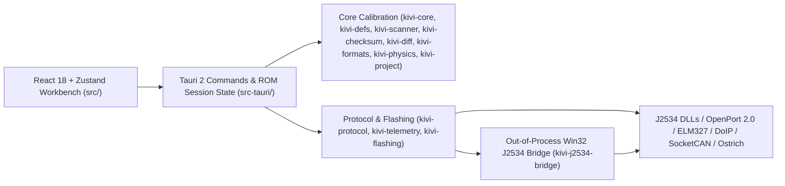

<div align="center">


# kiviTuner

Cross-platform ECU binary calibration, structural map discovery, multi-OEM checksum workbench, and hardware flashing studio built with Rust, Tauri, and React.

[](https://github.com/kaivyy/kiviTuner/actions/workflows/build-desktop.yml)
[](https://github.com/kaivyy/kiviTuner/releases)
[](LICENSE)
[](Cargo.toml)

[Installers](#installers) · [Capabilities](#capabilities) · [Hardware Support](#hardware-support) · [Architecture](#architecture) · [Development](#development) · [Documentation](#documentation)

</div>

---

<p align="justify">kiviTuner pairs a Rust calibration and flashing engine (<code>src-tauri</code> and 12 workspace crates) with a single-owner React workbench (<code>src/</code>) in both Carbon Dark and Lab Light themes. All calibration edits isolate against an immutable stock baseline so live deltas, differential sector flash plans, and one-key rollbacks stay exact.</p>

## Installers

<p align="justify">Prebuilt desktop bundles are published on <a href="https://github.com/kaivyy/kiviTuner/releases">GitHub Releases</a> from tag builds (<code>v*</code>) via <a href=".github/workflows/build-desktop.yml">build-desktop.yml</a>.</p>

| Platform | Target Architecture | Package Formats | Notes |
|---|---|---|---|
| Windows 64-bit | `x86_64-pc-windows-msvc` | `.exe` (NSIS), `.msi` (WiX) | Recommended on Windows. Bundles `kivi-j2534-bridge-x86.exe` so 64-bit direct and legacy 32-bit J2534 vendor DLLs both work. |
| Windows 32-bit | `i686-pc-windows-msvc` | `.exe` (NSIS), `.msi` (WiX) | Native 32-bit build for x86 Windows systems or direct in-process 32-bit J2534 DLL loading. |
| Linux | `x86_64-unknown-linux-gnu` | `.deb`, `.rpm`, `.AppImage` | Uses `libwebkit2gtk-4.1`, `libudev`, SocketCAN, and USB-CDC serial transports. |
| macOS (Apple Silicon) | `aarch64-apple-darwin` | `.dmg`, `.app.tar.gz` | Native ARM64 desktop bundle (macOS 10.15+). |
| macOS (Intel) | `x86_64-apple-darwin` | `.dmg`, `.app.tar.gz` | Native x86_64 desktop bundle (macOS 10.15+). |

<p align="justify">Running <code>npm run dev</code> also provides a browser-safe workspace fallback for <code>.bin</code>/<code>.rom</code>/<code>.hex</code>/<code>.s19</code> editing, Keihin 8-bit checksum repair, heuristic map scanning, 2D/1D/3D/Waveform/Hex views, and Undo/Redo without native hardware drivers.</p>

## Capabilities

| Domain | Included Functionality |
|---|---|
| Map & Curve Editing | Collapsible nested `Map Explorer` category folders, horizontally scrollable `WorkspaceTabBar` with wheel/arrow controls, scrollable 2D heatmap grid, interactive `1xN` / `Nx1` curve and row-slice chart, calibrated 3D surface viewer (camera-aware cage, X/Y/Z axis ticks, color legend, base ROM ghost wireframe), `Split 3D` / `Full 3D` / `2D Table` instant switching with LRU matrix caching, and TSV clipboard + Paste Special. |
| Binary & Map Discovery | Virtualized 4 KiB LRU hex inspector with live Data Inspector (`u8`/`i8`/`u16`/`i16`/`u32`/`i32`/`f32` LE/BE), 2D binary waveform scrubber, upgraded `blind_v2` structural 2D/1D scanner (`u8`-header OEM structs, signed zero-crossing `i16`/`i8`, Geary's C, Bartels RVN, turning-point gates, rule classifier, Fisher-Yates null checks), mutually exclusive `Discovery Scanner` and `Inspector` panels, address-gated binary diff, and stock SHA-256 registry. |
| Checksum Engines | Native verify/repair engines for Keihin, Honda, Bosch EDC15/EDC16/EDC17/ME3/ME7/MG1 GF(2), BMW MS41/MS43/GS20/EM2K, GM P01 to E92, Subaru Denso/Hitachi, VAG Simos, generic CRC/sum, XDF checksum blocks, and declarative JSON checksum plugins. |
| Formats & Definitions | Reads and exports `.bin`, `.rom`, Intel `.hex`, Motorola `.s19`, `.vbf`, `.xdf`, `.a2l`, DAMOS/SPZ/UMP, `.kp`, `.kivi.json`, Speeduino/MegaSquirt `.ini`, and CSV map definitions. |
| Desktop Shell, Telemetry & Updates | Native global macOS top menu bar integration next to the Apple icon (`native_menu.rs`), borderless outer-rounded OS and floating tool windows, unified 36px borderless workspace headers, exclusive `ActivityRail` focus indicator, low-RAM WebView2 tuning with lazy tool bundles, multi-transport ELM327/K-Line/OBD/UDS/Motorcycle diagnostics, Auto-Tune review, and built-in GitHub Releases updater (`SHA256SUMS.txt` verification + one-click restart). |

## Hardware Support

<p align="justify">kiviTuner communicates over SAE J2534 PassThru adapters, native USB serial interfaces, Ethernet DoIP gateways, and Linux SocketCAN. See the <a href="docs/hardware/drivers-and-interfaces.md">Drivers and Hardware Interfaces Guide</a> for Windows 32/64-bit bridging, Linux <code>udev</code>/SocketCAN setup, and vendor driver details.</p>

| Interface / Protocol | Transport Layer | Driver / Setup Requirement | OS Support |
|---|---|---|---|
| SAE J2534 PassThru (`op20pt64`, `op20pt32`, `smj2534`, `mvci`) | `libloading` FFI + Win64-to-Win32 NDJSON IPC bridge | Vendor PassThru DLL installed on host | Windows 64-bit, Windows 32-bit |
| Tactrix OpenPort 2.0 USB-CDC | Built-in `serialport` protocol stack | Linux kernel `cdc_acm` inbox (`/dev/ttyACM*`); Tactrix Windows INF or USB serial driver | Windows, Linux, macOS |
| ELM327 / STN11xx / OBDLink | Async `tokio-serial` (`115,200` / `38,400` bps) | Standard OS FTDI/CP210x/CH340 USB-UART driver | Windows, Linux, macOS |
| DoIP (ISO 13400-2) | Native TCP/UDP sockets (port `13400`) | Standard OS TCP/IP networking | Windows, Linux, macOS |
| Linux SocketCAN (`CAN_RAW`) | Kernel `AF_CAN` sockets via `libc` (`can0`, `vcan0`) | Linux SocketCAN kernel modules (`ip link set can0 up`) | Linux |
| Moates Ostrich 2.0 | High-speed USB serial emulator | Standard FTDI VCP serial driver | Windows, Linux, macOS |
| Speeduino / MegaSquirt INI Serial | Typed binary page telemetry/tuning serial driver | Standard USB-UART serial port | Windows, Linux, macOS |

## Architecture



| Crate / Module | Responsibility |
|---|---|
| `src/` | React 18 UI: `KiviMenuBar` (with native macOS global menu event bridge), exclusive `ActivityRail` focus indicator, scrollable `WorkspaceTabBar`, `MapTreeSidebar`, `HeatmapTable`, `CurveProfileChart`, `Surface3DView`, `KiviWaveform`, `HexdumpView`, mutually exclusive `ScannerDrawer` and `InspectorSidebar`, plus lazy-loaded floating and standalone OS pop-out tool windows. |
| `src-tauri/` | Single-owner multi-document ROM session state (`memory` + immutable `original_memory`), 4 KiB hex/waveform paging, macOS global native menu builder (`native_menu.rs`), borderless outer-rounded DWM window manager with low-RAM WebView2 tuning (`window_manager.rs`), GitHub Releases updater (`updater.rs`), and streaming IPC commands. |
| `crates/kivi-core` | Zero-copy memory map, signed/unsigned int & `f32` LE/BE decoders, rounded write-back, affine scaling, SHA-256 hashing, and undo/redo patch stack. |
| `crates/kivi-defs` | Parsers and exporters for `.xdf`, `.a2l`, DAMOS/SPZ/UMP, `.ini`, `.kivi.json`, CSV, interpolation, and smoothing math. |
| `crates/kivi-scanner` | `blind_v2` multi-brand structural map/curve discovery, 16-bit window scanner, heuristic detector, rule classifier, signature scripts, and stock ROM index. |
| `crates/kivi-checksum` | Multi-OEM checksum verification/repair, XDF checksum evaluator, and declarative JSON checksum plugins. |
| `crates/kivi-diff` | Address-gated firmware binary diff engine across raw BIN, Intel HEX, S-Record, and VBF images. |
| `crates/kivi-formats` | VBF, Intel HEX/S-Record containers, and GM E92 RLE compression codecs. |
| `crates/kivi-physics` & `crates/kivi-telemetry` | Engine/injector/VE calculators, OBD/CAN correlation, hit tracing, and Auto-Tune recommendation filtering. |
| `crates/kivi-project` & `crates/kivi-protocol` | Project workspace serialization, read-only OBD-II codec/session state machine, Speeduino/MegaSquirt INI serial driver, and CSV datalog playback. |
| `crates/kivi-flashing` & `crates/kivi-j2534-bridge` | Unified `Device` / `KernelSession` pipeline, J2534 FFI + 32-bit IPC bridge executable, OpenPort 2.0 USB-CDC, ELM327, DoIP, TP 2.0, SocketCAN, Bus Flight Recorder, differential flash safety gates, and Write Lock. |

## Development

<p align="justify">Prerequisites: <strong>Node.js 24+</strong> (or Node 22.18+ for native TypeScript test execution) and the <strong>Rust stable</strong> toolchain. On Linux, desktop Tauri builds also require the GTK/WebKit system packages listed in the <a href="docs/guides/building-and-packaging.md">Building and Packaging Guide</a>.</p>

```bash
# 1. Install frontend dependencies
npm ci

# 2. Run browser preview (Vite dev server)
npm run dev

# 3. Verify Rust workspace & native hardware/protocol crates
cargo clippy --workspace --all-targets -- -D warnings
cargo test -p kivi-core -p kivi-checksum -p kivi-formats -p kivi-flashing -p kivi-protocol -p kivi-j2534-bridge -p kivituner

# 4. Verify frontend types, unit tests, and production bundle
npx tsc --noEmit
npm test
npm run build

# 5. Build native desktop installer on current host OS
npx --yes @tauri-apps/cli@2 build
```

## Keyboard Shortcuts

| Shortcut | Action |
|---|---|
| `F1` / `Ctrl+K` | Keyboard Shortcuts modal / Command Palette |
| `Ctrl+O` / `Ctrl+D` | Open ROM image / Load definition file |
| `Ctrl+S` / `Ctrl+Shift+S` | Save ROM / Save As |
| `Ctrl+Z` / `Ctrl+Y` | Undo / Redo edit |
| `Ctrl+F` / `Ctrl+B` / `Ctrl+\` | Discovery Scanner / Binary Diff / Split 3D view |
| `Arrows` / `Shift+Arrows` / `Enter` | Move grid cursor, extend selection, edit cell |
| `+` / `-` / `=` / `%` / `*` | Step cell values, set constant, or scale selection |
| `S` / `I` / `H` / `V` | Smooth 3x3 / Bilinear, Horizontal, Vertical interpolate |
| `Backspace` / `Delete` | Revert selected cells to stock baseline |

## Documentation

| Document | Contents |
|---|---|
| [Getting Started Guide](docs/guides/getting-started.md) | End-to-end ROM opening, definition loading, discovery scanning, table editing, diffing, checksums, and saving. |
| [Checksum Engines & JSON Plugins](docs/guides/checksum-plugins.md) | Built-in OEM checksum algorithms and declarative JSON custom checksum plugin schema and examples. |
| [Design System & Workspace Architecture](DESIGN.md) | Visual tokens (Carbon Dark / Lab Light AA ratios), single-owner shell, and store concurrency model. |
| [Drivers and Hardware Interfaces](docs/hardware/drivers-and-interfaces.md) | OS vs built-in vs vendor J2534 drivers, Linux `udev` / SocketCAN, Win64 32-bit bridge, and troubleshooting. |
| [Building and Packaging Installers](docs/guides/building-and-packaging.md) | 5-target GitHub Actions release matrix, local Windows/Linux/macOS build commands, and CI cache/CLI setup. |
| [Release Process](docs/guides/releasing.md) | Version-bump checklist across workspace manifests, tagged auto-publish flow, and manual draft workflow runs. |
| [Hardware Bench Validation Guide](docs/guides/hardware-bench-validation.md) | Mandatory stock-first read/diff/checksum/verify checklist and bench power supply bounds. |
| [OBD-II Serial Compatibility Matrix](docs/hardware/obd_serial_compatibility.md) | ELM327 / STN compatibility matrix, PID decoding rules, and physical acceptance test protocol. |
| [Contributing Guide](CONTRIBUTING.md) | Development prerequisites, required Rust and TypeScript test suite commands, and engineering invariants. |
| [Changelog](CHANGELOG.md) | Version history and release summary starting from `v0.1.0`. |

## Safety Notice

<p align="justify">Automated software tests validate protocol encoding, seed-key math, checksum repair, and safety interlocks against mock transports and local harnesses, not physical silicon on your vehicle. Always verify voltage with a stabilized <code>12.6 V</code> to <code>13.8 V</code> bench supply (<code>&gt;= 10 A</code>), capture and hash a stock ECU readback before making edits, run checksum verification prior to flashing, and follow the <a href="docs/guides/hardware-bench-validation.md">Hardware Bench Validation Guide</a>. Hardware operations remain the operator's responsibility.</p>

## License

Released under the [MIT License](LICENSE).
